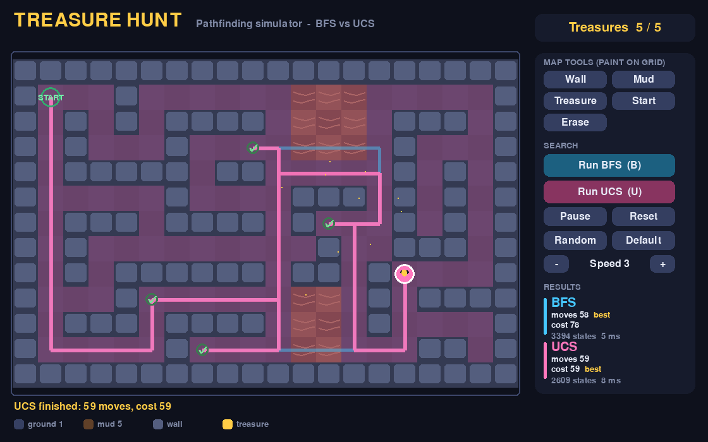
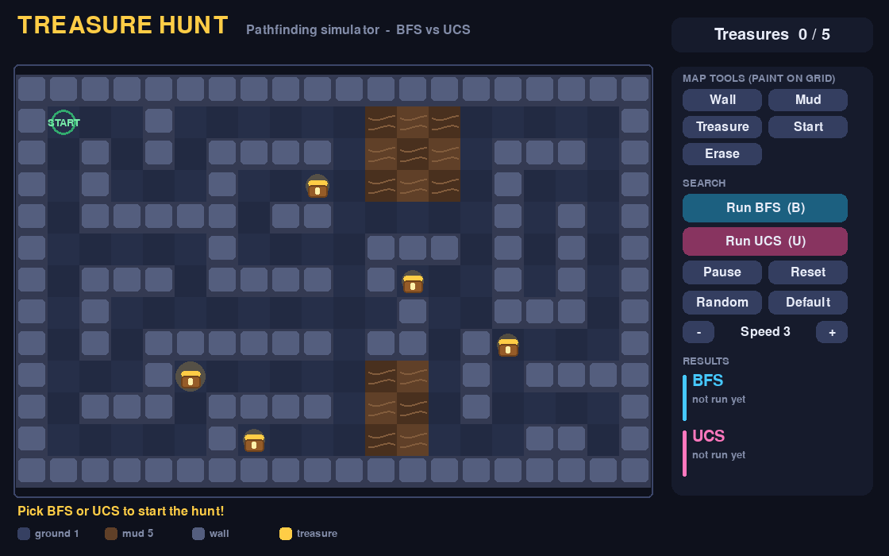
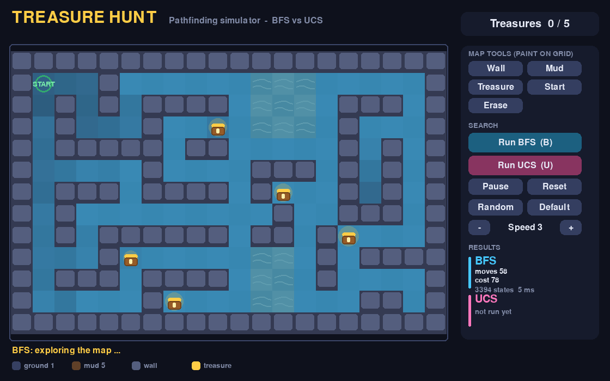
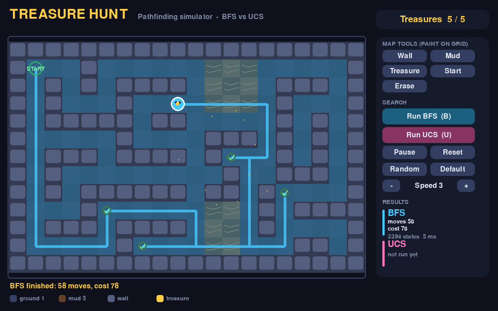

# Treasure Hunt Simulator

A pathfinding project in which an agent must collect **all** treasures scattered on a grid map as efficiently as
possible. The route is found with two classic uninformed search algorithms, **Breadth-First Search (BFS)** and
**Uniform-Cost Search (UCS)**, and the two are compared side by side in an interactive pygame GUI.



## Team

| Name | Roll No. |
|---|---|
| Akash | B24CS004 |
| Arush | B24DS002 |
| Murali | B24ME010 |
| Naveen | B24CS001 |
| Sathish | B24ME011 |

## What the project does

- Models the hunt as a state-space search where the state is `(row, col, treasures collected)`, so the search
  decides the best order in which to visit the treasures.
- **BFS** finds the route with the fewest moves. It ignores terrain cost.
- **UCS** finds the route with the lowest total cost. It avoids expensive mud when a cheaper way exists.
- Shows both results next to each other so the difference is easy to see.

On the default map both algorithms collect all 5 treasures:

| Algorithm | Moves | Total cost | States expanded |
|---|---|---|---|
| BFS | 58 | 78 | 3394 |
| UCS | 59 | 59 | 2609 |

BFS needs one move fewer but walks through mud; UCS takes one extra move and is much cheaper overall. The full
problem formulation is in [docs/PROBLEM_MODELLING.md](docs/PROBLEM_MODELLING.md) and the complete write-up is in
the **[project report (PDF)](docs/PROJECT_REPORT.pdf)**.

## Project report

The complete project report (problem statement, modelling, algorithms, implementation, experiments on 240 random
maps, discussion and conclusion) is available as a PDF: **[docs/PROJECT_REPORT.pdf](docs/PROJECT_REPORT.pdf)**.

## Features of the GUI

- Heat-map animation of the cells each algorithm explores, then an agent walks the final path.
- Treasure counter, collection effects, and a results panel (moves, cost, states expanded, time).
- Map editor: paint walls, mud, treasures and the start cell with the mouse.
- Random map generator that always produces a solvable map, plus a Default button.
- Pause, reset and adjustable speed. Press `C` to draw both paths at once.

| Start screen | Exploring | Result |
|---|---|---|
|  |  |  |

## Getting started

Requires Python 3.8 or newer (developed and tested on Python 3.13).

```bash
git clone <your-repository-url>
cd <repository-folder>
pip install -r requirements.txt     # installs pygame
```

Run the GUI:

```bash
python3 treasure_hunt_gui.py
```

Click **Run BFS** and **Run UCS** and compare the paths.

| Control | Action |
|---|---|
| `B` / `U` | Run BFS / UCS |
| `Space` | Pause / resume |
| `R` | Reset results |
| `N` | New random map |
| `D` | Restore the default map |
| `C` | Show both paths on the map |
| `+` / `-` | Change speed |
| Mouse | Click buttons; pick a map tool, then click or drag on the grid to paint |

## Project structure

```
.
├── treasure_hunt_gui.py        # the whole program: BFS + UCS solver and pygame GUI
├── docs/
│   ├── PROJECT_REPORT.pdf      # full project report (PDF)
│   ├── PROBLEM_MODELLING.md    # state, actions, cost, goal test, algorithms
│   └── screenshots/            # images used in the README and report
├── requirements.txt
└── LICENSE
```

## Limitations

- Movement is 4-directional on a grid, and terrain costs are fixed at 1 (ground) and 5 (mud).
- The state space grows as `2^(number of treasures)`, so maps with many treasures become slow
  for BFS and UCS. A heuristic search such as A* would be a natural next step.

## License

Released under the [MIT License](LICENSE).
